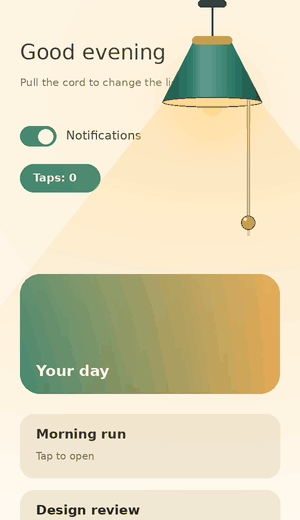

# PullLamp

A pull-cord lamp that switches your Jetpack Compose app between light and dark mode.



> The preview is drawn by a script (`tools/render_preview.py`). The cord and lamp motion in it comes from
> this library's real rope engine, but the picture itself is re-created, so it is not a recording of the
> Compose UI.

Pull the bead on the cord and the light clicks. The new look then spreads across the screen in a circle
from the bulb, and the bulb throws a warm cone of light over your content. Let go and the cord springs back
and swings until it hangs still.

## Prior art (please read)

The idea of a pull-cord lamp as a theme switch is not new. Web versions exist (for example Pullcord and
Rope Toggle on Framer, and Pull Cord components on 21st.dev), and a Compose showcase of the same idea has
been shown publicly. PullLamp is an open, tested Compose library of it, with a Material 3 friendly API, real
rope physics and accessibility built in. It does not claim to have invented the concept.

## Status

- The cord and lamp physics (`CordSimulation`, `LampRig`) are plain Kotlin with unit tests, and those tests
  pass.
- The Compose layer (drawing, gestures, light, spreading reveal), the sample app and the on-device tests were
  written without access to the Android build tools, so they have **not been compiled or run yet**. Expect to
  fix a few small build errors on the first build and please open an issue if you hit one.

## Install

The library is not published to Maven yet. For now, copy the `pulllamp` module into your project, or
publish it locally with `./gradlew :pulllamp:publishToMavenLocal`.

```kotlin
dependencies {
    implementation("com.raiyanshahid:pulllamp:0.1.0")
}
```

## Use

```kotlin
@Composable
fun App() {
    val lamp = rememberLampState(initialOn = true)

    LampScene(state = lamp, modifier = Modifier.fillMaxSize()) {
        // Your theme follows the lamp. This is composed once, so your state survives the switch.
        MaterialTheme(colorScheme = if (lamp.isOn) lightColorScheme() else darkColorScheme()) {
            Surface(Modifier.fillMaxSize()) { YourScreen() }
        }
    }
}
```

`lamp.isOn` is light mode and `lamp.isDark` is dark mode. Keep buttons out of the lamp's corner (top end by
default): the lamp takes the touches there.

You can also switch from code, which plays the same animation:

```kotlin
scope.launch { lamp.toggle() }        // or lamp.setOn(false)
```

## Customise

```kotlin
LampScene(
    state = lamp,
    lampAlignment = Alignment.TopStart,
    style = LampStyle(
        shadeColor = Color(0xFFB5452F),
        lightColor = Color(0xFFFFE0B0),
        scale = 0.8f,
        lightBlendMode = BlendMode.Screen,   // real-light look on dark designs
        offDescription = "Dark mode",
        onDescription = "Light mode",
    ),
)
```

`rememberLampState(revealMillis = 0)` switches instantly with no spreading circle.

## How it works

- The cord is a chain of 15 points moved by position-based Verlet integration. It is slightly elastic, so it
  stretches when pulled and springs back, and it clicks once when pulled past a threshold.
- The lamp hangs from a ceiling cable as a damped pendulum. The cord hangs from the lamp, so a swing carries
  the cord and a sideways tug leans the lamp.
- At the click, the scene takes a picture of your content, flips your theme, and draws the picture back on
  top outside a circle that grows from the bulb. Your content is composed only once, so scroll position and
  other state are kept.
- The animation loop only runs while something moves, so an idle lamp costs nothing.

## Accessibility

The lamp is exposed as a switch with a state ("Light on" / "Light off"). A tap on the shade or the bead pulls
the cord for you, and screen reader activation does the same, so nobody has to drag. Set the strings in
`LampStyle` to match your app's language.

## Tests

```bash
./gradlew :pulllamp:testDebugUnitTest                              # rope and lamp physics (JVM)
./gradlew :pulllamp:connectedDebugAndroidTest :sample:connectedDebugAndroidTest   # needs an emulator
```

## License

Apache 2.0. See [LICENSE](LICENSE).
